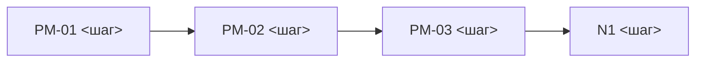

# План пересборки карты
Основание: <материал или встреча: kb/materials/meetings/…md>

Скопируйте в `_map-plan.md`, заполните, покажите человеку. После «ок» — `python3 kb/tools/kb.py map apply`.
Проверить без изменений — `map apply --check`.

## План
Каждый шаг карты — одна строка. Новый шаг — N1, N2… (номер PM-XX даст команда). Разделить — «PM-04 … + N1 …». Объединить — в «Станет» один существующий ID. Убрать — «—».

| Было | Станет | Что | Почему (источник) |
|---|---|---|---|
| PM-01 <шаг> | PM-01 <шаг> | без изменений | — |
| PM-02 <шаг> | PM-02 <новое имя> | переименовать | <файл, строка> |
| PM-03 <шаг> | PM-03 <шаг> + N1 <новый шаг> | разделить | <файл, строка> |
| — | N2 <новый шаг> | новый шаг | <файл, строка> |
| PM-04 <шаг> | PM-02 | объединить | <файл, строка> |

## Схема
Новая схема целиком. Узлы новых шагов — N1, N2: `N1["N1 <шаг>"]`.

