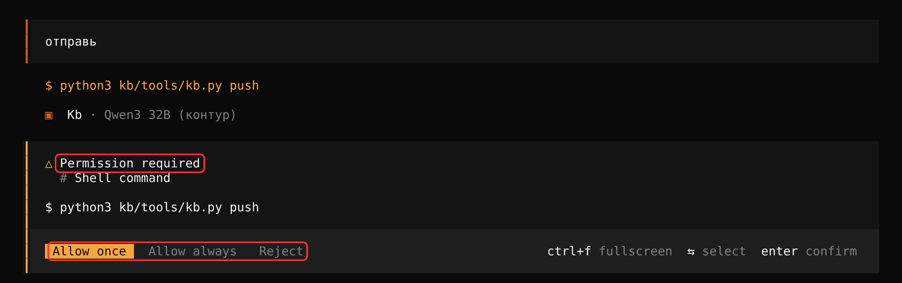

# Git: все в context, отправляет агент

## Коротко

1. Все работают в одной ветке — `context`. Агент сам ветки не переключает и не создаёт. Своих веток и MR для базы знаний нет, пока вы сами не попросите отдельную ветку (раздел «Отдельная ветка»).
2. Отправляет только агент и **только с вашего согласия**: вы пишете «отправь» или отвечаете «да» на его вопрос «Отправить в context?». Сам агент не отправляет никогда. Сами `git push` тоже не делайте.
3. Перед отправкой агент покажет свежие правки коллег в ваших файлах и спросит, отправлять ли.
4. Простые конфликты агент решает сам. Если одну строку два человека поменяли по-разному, агент покажет обе версии, а выберете вы.
5. После отправки агент даст **текст для группы**. Перешлите его в чат команды.

Код продукта живёт по правилам своего репозитория. Этот документ — только про базу знаний (`kb/`).

## Один раз

**Техлид, при создании репозитория:**
1. Создайте ветку: `git checkout -b context && git push -u origin context`.
2. Разрешите push в `context` всем разработчикам.
   - GitLab: Settings → Repository → Protected branches → `context` → Allowed to push: Developers.
   - GitHub: правило защиты для `context` не ставьте или разрешите push команде и GitHub Actions.
3. Включите CI. Он раздаёт номера вопросам и пересобирает сводки после каждой отправки.
   - GitLab: `.gitlab-ci.yml` уже в репозитории. Нужна переменная `KB_PUSH_TOKEN` (Settings → CI/CD → Variables).
   - GitHub: `.github/workflows/kb.yml` уже в репозитории. Settings → Actions → General → Workflow permissions → «Read and write permissions».
4. Ветка называется не `context` — поменяйте в трёх местах: поле `основная ветка` в `kb/team.md`, `KB_BRANCH` в `.gitlab-ci.yml`, `context` в `.github/workflows/kb.yml`.

**Каждый, на своём компьютере:**
1. `git clone <адрес>` и `git checkout context`.
2. `git config user.name "Имя"` и `git config user.email "рабочая почта"`.
3. Аналитик добавил вас в `kb/team.md`.

## Рабочий день

| Когда | Что сказать агенту | Что он делает |
|---|---|---|
| Начало дня | `/kb-next` | Обновляет `context`, показывает новые ответы и что делать |
| Берёте рут | `/kb-take PM-04` | Записывает вас владельцем и **сразу отправляет**. Пока взятие не отправлено, рут для других свободен |
| Работаете | `/kb-explore PM-04` | Записывает факты и вопросы, коммитит маленькими кусками |
| Закончили кусок | «отправь» или `/kb-push` | Проверка, свежие правки коллег, конфликты, отправка, текст для группы |
| Нарезали рут на карточки | «отправь» | В тексте для группы появится «НОВЫЕ КАРТОЧКИ — можно брать» |

Отправляйте часто — после каждого раздела или пачки вопросов. Чем дольше работа лежит у вас, тем больше расхождений с коллегами и тем позже они увидят ваши вопросы.

## Отправка — только с вашего согласия

Это жёсткое правило (`AGENTS.md`, правило 10). Его держат два замка:

1. **Правило агента.** Без вашего «отправь» или «да» агент не вызывает `kb.py push`. Одно согласие — одна отправка. «Я закончил», «разбери», «работай» — не согласие: агент спросит «Отправить в context?».
2. **Подтверждение в самом инструменте.** OpenCode и Claude Code сами спрашивают вас перед каждым `kb.py push` — даже если модель нарушит правило. Прямой `git push` агенту запрещён совсем: инструмент его не выполнит. Это настроено в `opencode.json` и `.claude/settings.json`.

Так выглядит подтверждение в OpenCode:



| Где | Что выбрать | Чего не выбирать никогда |
|---|---|---|
| OpenCode | **Allow once** — отправить; **Reject** — не отправлять | **Allow always** — дальше агент будет отправлять без вопроса |
| Claude Code | **Yes** — отправить; **No** — не отправлять | «Yes, and don't ask again», режим `bypassPermissions` и запуск с `--dangerously-skip-permissions` — они отключают вопрос |

Случайно выбрали «Allow always» — закройте сессию и начните новую. В Claude Code уберите строку `kb.py push` из `allow` в `.claude/settings.local.json`.

Без человека агент не отправляет: дежурство по расписанию или ночной прогон оставляют коммиты у себя и пишут «ждёт отправки».

## Что агент покажет перед отправкой

Если коллеги за это время меняли ваши файлы, агент остановится и покажет:

```
== В context свежие правки коллег в ваших файлах

# kb/journal/questions/Q-new-istochnik-dolga.md
  d15f066 Ира 14.10 11:30: Q: подписчик
  -- <кто>
  +- Аня — для карты

== Что будет при обновлении
Конфликт в файлах: kb/journal/questions/Q-new-istochnik-dolga.md. Дописанные строки агент сольёт сам;
одну и ту же строку, изменённую по-разному, покажет вам.
```

Прочитайте и ответьте «да, отправляй» или «подожди». После «да» агент обновится и отправит.

## Конфликты: что агент решает сам, а что спросит

| Что случилось | Что делает агент |
|---|---|
| Коллега поменял другие места вашего файла | Ничего не спрашивает: git сливает сам |
| Вы и коллега дописали строки в одно место: подписчики, история, новые факты | Оставляет обе. Пишет «оставлены обе» |
| Сгенерированные файлы: `_index.md`, карта | Берёт версию `context`. CI пересоберёт |
| Одну и ту же строку поменяли по-разному | **Спрашивает вас** |
| Рут или карточку уже взял другой | Отменяет ваше взятие и говорит, кто взял |

Пример, когда агент спрашивает:

```
kb/journal/questions/Q-001-istochnik-dolga.md: одна и та же строка изменена по-разному
      было:       В выгрузке две суммы.
      в context:  В выгрузке две суммы: долг и пеня.
      у вас:      В выгрузке две суммы: с НДС и без.
НУЖЕН ЧЕЛОВЕК
```

Ответьте одним из вариантов:
- «оставь из context»;
- «оставь мою»;
- «оставь обе»;
- своя формулировка: «напиши: две суммы — долг и пеня, обе с НДС и без».

Агент исправит файл и продолжит отправку. Передумали — «отмени отправку»: всё вернётся как было.

## Двое взяли один рут

Ира и Марат почти одновременно сказали «возьми PM-03». Ира отправила первой. У Марата агент напишет:

```
ВЗЯТО ДРУГИМ  kb/context/process/PM-03-reestr.md — в context уже владелец рута: Ира.
Ваше взятие не отправлено.
Ваш единственный неотправленный коммит — взятие: он отменён, context обновлена.
```

Марат берёт следующий рут. Так же работает гонка за карточку.

## Текст для группы

После каждой отправки агент печатает готовый текст. Например, владелец нарезал рут на карточки:

```
Отправил(а) в context — Ира
• НОВЫЕ КАРТОЧКИ — можно брать:
   – PM-01-K01 «Исключения в выгрузке»
   – PM-01-K02 «Объём и пики»
   Взять: /kb-take <ID карточки>; весь список — python3 kb/tools/kb.py cards
Перед работой обновитесь: попросите агента «обнови context» (git pull --rebase).
```

Перешлите его в чат команды как есть. В тексте бывают:
- новые факты по шагам;
- новые вопросы и ответы;
- смена статусов;
- руты «Готов к взятию»;
- новые карточки.

Потеряли текст — «покажи текст для группы» (`kb.py announce`).

Отдельного ревью до `context` нет. Его заменяют три вещи:
- текст для группы — сигнал коллегам посмотреть;
- первый рут новичка аналитик смотрит до сверки с бизнесом;
- архитектор недели проверяет рут целиком на приёмке.

## Журнал изменений контекста

Каждая отправка дописывает запись в `kb/journal/context-log.md`:

```
### 2026-10-14 13:40 · Ира → context
- PM-04 «Проверка оплат»: +5 факт(ов) (Правила, Исключения)
- Вопросы:
   – Q-new-istochnik-dolga «Откуда берётся сумма долга?» (бизнес-правило, PM-04) — новый
- Дальше: разобрать раздел «Объём и время»
```

Запись делает `kb.py push` сам — агент не может её забыть. «Дальше» берётся из последней заметки сессии.

Зачем: новая сессия, другой компьютер или другой человек продолжают с того же места. Скажите агенту «продолжи» — он запустит `kb.py resume` и покажет:
- ваши последние отправки и что вы собирались делать дальше;
- что коллеги отправили после вас.

Весь журнал — `kb.py log 20`, одного человека — `kb.py log 10 --who Ира`. Руками журнал не правят.

## Отдельная ветка — только по вашей просьбе

Хотите вести разработку контекста отдельно, например черновик большой переделки карты? Скажите агенту имя ветки: «создай ветку context-karta-v2».

| Что | Что сказать агенту | Что произойдёт |
|---|---|---|
| Создать | «создай ветку context-karta-v2» | `kb.py branch context-karta-v2` — ветка от свежей `context`, вы в ней |
| Отправить работу | «отправь» | Уходит в `context-karta-v2`, `context` не трогается |
| Влить в `context` | «влей ветку в context» | `kb.py push --into context`: свежие правки коллег, конфликты, отправка в `context`, текст для группы |
| Вернуться в `context` | «переключись в context» | `git checkout context && git pull --rebase` |

Агент без вашей просьбы ветку не создаёт, не переключает и не вливает. Руты и карточки берут только в `context`.

## Чего не делать

| Не делайте | Почему | Как правильно |
|---|---|---|
| `git push` руками | Пропустите проверку и не увидите правки коллег | «отправь» |
| `git push --force` | Сотрёте чужую работу в `context` | Никогда для `context` |
| Ветки «на всякий случай» | Коллеги не видят ваши вопросы и взятые руты | Всё в `context`; отдельная ветка — когда правда нужна, по вашей просьбе |
| `git add -A`, `git commit -a` | В коммит попадут чужие и сгенерированные файлы | Агент коммитит свои файлы по именам |
| Править чужой шаг | Два писателя — конфликты по смыслу | Вопрос владельцу (`kb-ask`) |
| Копить работу днями | Конфликтов больше, вопросы видят поздно | Отправлять после каждого куска |

## Нет доступа к серверу

`kb.py push` пишет «ОШИБКА ДОСТУПА» с причиной и тем, что сделать. Агент сам доступ не чинит: не меняет адрес сервера, не ищет пароли и токены, не отправляет «в обход». Это правило — чтобы токен не попал в команды и логи, а `kb.py push` видел настоящую копию `context`.

| Причина | Как исправить — один раз, в том терминале, где работает агент |
|---|---|
| `origin` по SSH, а ключа в этой среде нет. На Windows ключ лежит в `%USERPROFILE%\.ssh`, а OpenCode может запускать команды в WSL со своей пустой `~/.ssh` | Проверить: `ssh -T git@<сервер>`. Не проходит — положить ключ в эту среду или перевести `origin` на HTTPS: `git remote set-url origin https://<сервер>/<группа>/<проект>.git` |
| `origin` по HTTPS, пароль или токен не настроены или устарели | `git fetch origin` в обычном терминале, ввести данные — их запомнит Git Credential Manager |
| Сервер недоступен | Включить VPN или сеть |

Токен в адрес `origin` не вписывайте (`https://user:token@…`): он окажется в выводе команд. `kb.py push` предупредит, если найдёт такой адрес.

## Если что-то пошло не так

| Что | Что сказать агенту |
|---|---|
| Отправка застряла посреди конфликта | «отмени отправку» — `kb.py push --abort` |
| Сессия оборвалась во время отправки | «продолжи» — агент увидит незаконченное обновление и предложит закончить или отменить |
| Агент говорит, что вы не в `context` | Скажите, что это за ветка. Обычно её работу переносят в `context` и ветку удаляют |
| «kb.py check: ошибок N» | «исправь ошибки check» |
| Нет сети, `git fetch` не прошёл | Повторите позже. Коммиты лежат у вас и не потеряются |
