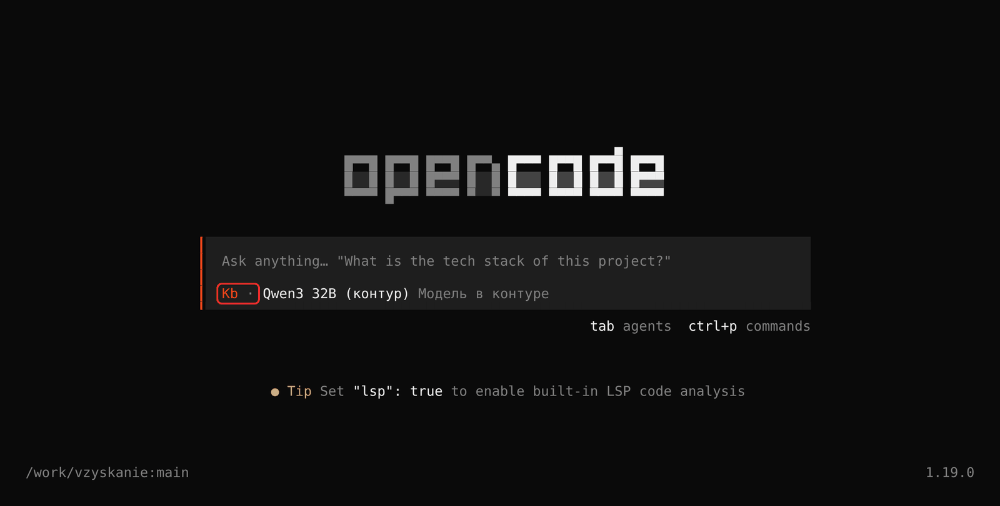
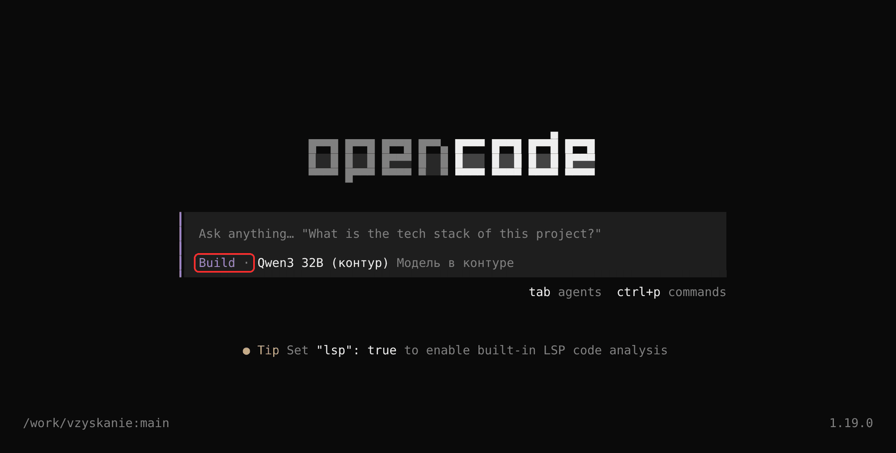
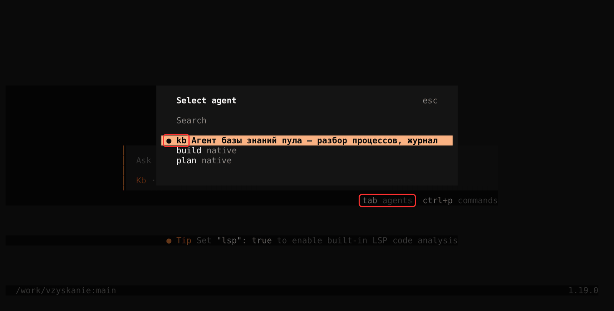
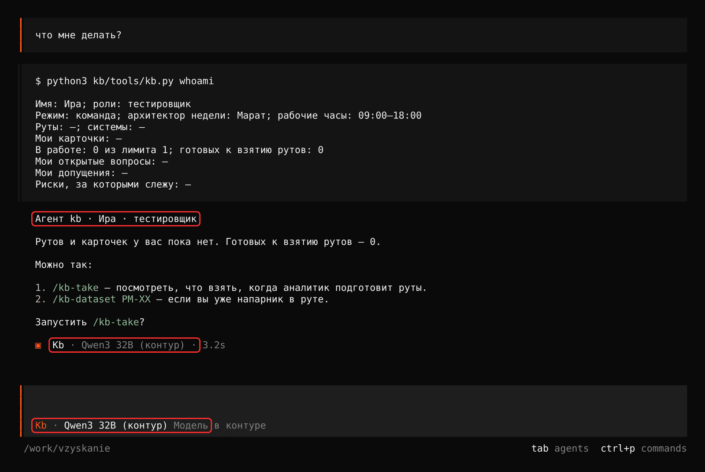
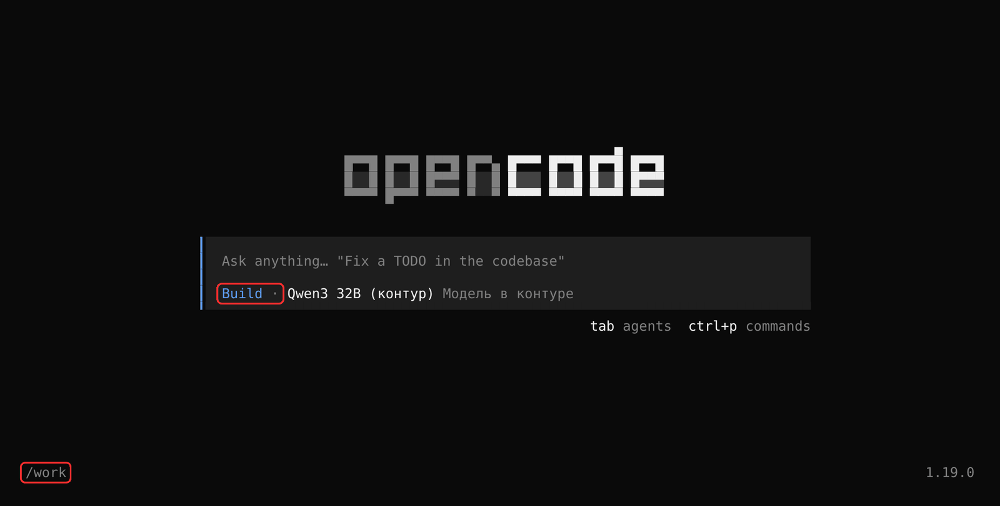
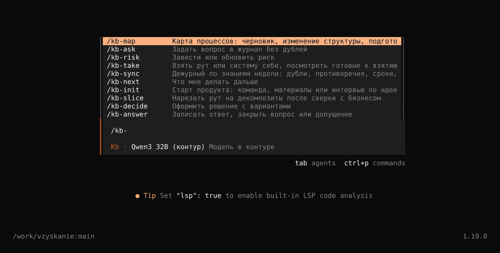
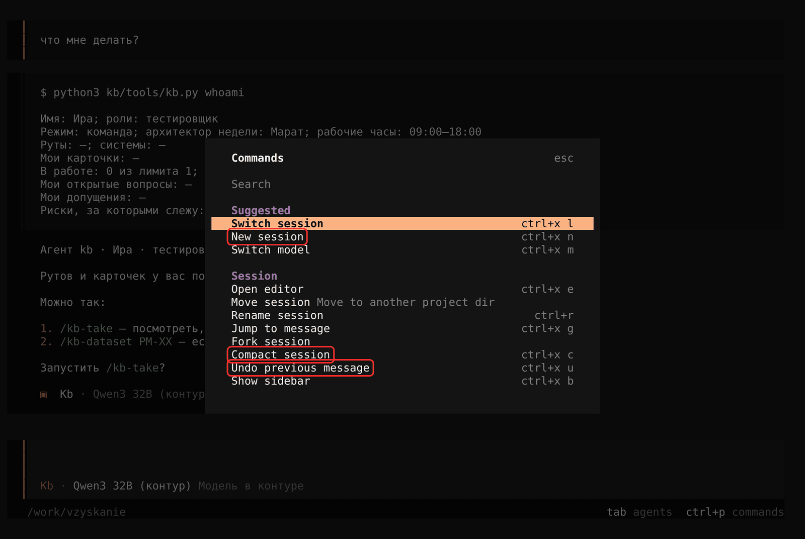

# OpenCode: как работать с агентом

## Коротко — пять правил

1. Открывайте OpenCode **в корне репозитория** — там, где лежат `AGENTS.md` и `opencode.json`.
2. **Проверьте, что выбран агент `kb`.** Не `Build` и не `Plan`. Как проверить — раздел 3.
3. Работайте **через команды** `/kb-…`, а не просто словами.
4. **Одна задача — одна сессия** (`/new`).
5. Агент ошибся — остановите его, скажите, что не так, и запишите замечание в `kb/FEEDBACK.md` (раздел 7).

## 1. Требования к модели

OpenCode работает с любой моделью, которая умеет вызывать инструменты: в своём контуре через vLLM, Ollama, LM Studio или любой сервер с OpenAI-совместимым API.

- **Вызов инструментов (tool calling)** — обязательно. На сервере он должен быть включён: в vLLM это флаги автоматического выбора инструмента и парсер вызовов для вашей модели.
- **Контекст** — от 32 тыс. токенов, лучше 64 тыс. и больше. Правила, скилл и выжимка шага занимают 8–12 тыс. токенов. Остальное уходит на работу.
- **Ответ** — от 4 тыс. токенов.
- **Русский язык** — модель уверенно пишет по-русски.

Модели слабее Claude чаще пропускают шаги, путают формат и не загружают нужный скилл сами. Поэтому работа в OpenCode устроена так, чтобы модели оставалось меньше решать:

| Что | Как помогает модели |
|---|---|
| Агент `kb` (`.opencode/agents/kb.md`) | Короткие жёсткие правила, температура 0,2, лимит 80 шагов, только русский язык |
| Команды `/kb-…` (`.opencode/commands/`) | Текст скилла и вывод `whoami` вставлены прямо в сообщение. Модели не нужно самой искать скилл |
| Команды записи `kb.py fact`, `new … поле=…`, `set`, `append` | Модель не правит markdown руками. Формат держит скрипт, ошибку он возвращает словом «ОШИБКА» |
| Выжимки `kb.py whoami`, `context`, `similar`, `changes`, `peek` | Меньше читать — меньше шанс потеряться в длинном контексте |
| `kb.py check` | Ловит факты без статуса, персональные данные, битые ссылки, неверные статусы |
| Сжатие контекста (`compaction.prune`) | OpenCode выбрасывает старые выводы команд. Длинная сессия влезает в окно модели |

Подходит ли модель, проверяйте экзаменом (раздел 8), а не на глаз.

## 2. Подключить модель — один раз

Модель подключается на компьютере, а не в репозитории продукта. Адреса и ключи в репозиторий не кладём.

1. В OpenCode: `/connect` → **Other** → ID провайдера, например `kontur` → ключ. Сервер без ключа — любая строка.
2. В `~/.config/opencode/opencode.json` (на Windows — `%USERPROFILE%\.config\opencode\opencode.json`):
   ```json
   {
     "$schema": "https://opencode.ai/config.json",
     "provider": {
       "kontur": {
         "npm": "@ai-sdk/openai-compatible",
         "name": "Модель в контуре",
         "options": { "baseURL": "http://<адрес-сервера>/v1" },
         "models": {
           "<id-модели-на-сервере>": {
             "name": "<как показывать в списке>",
             "limit": { "context": 65536, "output": 8192 }
           }
         }
       }
     },
     "model": "kontur/<id-модели-на-сервере>"
   }
   ```
   В этом файле **не ставьте** `default_agent`: он перебьёт агента `kb` из репозитория.
3. `/models` — выберите модель.

`limit.context` ставьте честно, по настройке сервера. По нему OpenCode решает, когда сжимать контекст.

Что уже настроено в репозитории:
- `opencode.json` — агент `kb` по умолчанию, сжатие контекста, разрешения. `kb.py` и чтение git идут без вопросов. `git push`, `git reset`, `rm` — с подтверждением.
- `.opencode/agents/kb.md` — правила агента.
- `.opencode/commands/kb-*.md` — команды со вставленным скиллом.
- `AGENTS.md` OpenCode читает сам.

## 3. Проверить агента `kb` — обязательно

**Зачем.** В OpenCode несколько агентов. Встроенные `Build` и `Plan` читают `AGENTS.md`, но не знают правил агента `kb`: шаг за шагом, только командами `kb.py`, низкая температура. `Plan` вообще не может писать файлы — разбор шага в нём не запишется. Слабая модель в `Build` чаще выдумывает и правит файлы руками.

Снимки ниже — OpenCode 1.19.0, модель в контуре, репозиторий продукта в папке `/work/vzyskanie`.

**Как проверить — перед первым сообщением в каждой сессии:**

**1. Посмотрите на название агента под полем ввода.** Должно быть `Kb`, оранжевым. Справа от него — модель.



Если там `Build` (синий или фиолетовый) или `Plan` — агент не тот:



**2. Не `Kb` — переключите.** Tab переключает по кругу: `Kb` → `Build` → `Plan` → `Kb`. Shift+Tab — в обратную сторону. Или наберите `/agents` и выберите `kb` стрелками и Enter:



В списке `/agents` нет `kb` — OpenCode открыт не в той папке (ниже).

**3. Отправьте первое сообщение и посмотрите на ответ.** Агент `kb` первым делом вызывает `kb.py whoami`. Первая строка его ответа — `Агент kb · <ваше имя> · <роль>`. Под каждым ответом OpenCode пишет, какой агент отвечал: `▣ Kb · <модель>`.



> На этом снимке ответ модели подставлен заглушкой — живой модели при съёмке не было. Интерфейс OpenCode, вызов `kb.py whoami` и его вывод — настоящие.

Строки `Агент kb` нет или под ответом `Build` — остановите агента (Esc), переключитесь на `kb`, повторите сообщение.

**Почему OpenCode может открыться не в `kb`:**

| Причина | Что сделать |
|---|---|
| OpenCode открыт в папке **выше** репозитория | OpenCode ищет `.opencode/` от текущей папки вверх. Из папки выше агента `kb` не видно — OpenCode молча берёт `Build`. Закройте и откройте в корне репозитория. Из вложенной папки (`kb/`) агент `kb` находится |
| Вы продолжили старую сессию | Сессия помнит своего агента. Старая сессия в `Build` останется в `Build`. Начните новую (`/new`) или переключите Tab |
| В личном `~/.config/opencode/opencode.json` стоит `default_agent` | Уберите эту строку |
| В `.opencode/agents/kb.md` ошибка после правки | OpenCode молча берёт `Build`. Верните файл: `git checkout -- .opencode/agents/kb.md` |
| Вы переключали агентов Tab и забыли вернуться | Смотрите на название под полем ввода перед отправкой |

Так выглядит запуск из папки выше репозитория. Внизу слева — путь `/work`, а не `/work/vzyskanie`; агент — `Build`:



Путь внизу слева — папка, в которой открыт OpenCode. В корне репозитория рядом с путём видна ветка git: `/work/vzyskanie:main`.

Команды `/kb-…` указывают агента `kb` в своём описании. Но обычное сообщение без команды уходит тому агенту, который выбран сейчас.

## 4. Как работать

- **Через команды.** `/kb-explore PM-04 …`, `/kb-sync утро`, `/kb-next`. Команда гарантирует, что модель увидит скилл целиком. Обычный текст без команды агент `kb` встретит предложением подходящей команды. Наберите `/kb-` — OpenCode покажет все команды с описанием:

  

- **Одна задача — одна сессия.** Разобрали раздел шага, закоммитили — `/new`. Модели с небольшим окном теряют начало длинной сессии. Вся память — в файлах, новая сессия ничего не потеряет.
- **Отвечайте на вопросы агента коротко.** Номер варианта или одна фраза: «2», «да, но только для физлиц».
- **Сессия оборвалась** — новая сессия, напишите `продолжи`. Агент запустит `kb.py resume` и покажет, на чём остановились.
- **Полезные команды OpenCode** — все есть в палитре Ctrl+P:

  | Команда | Клавиши | Зачем |
  |---|---|---|
  | `/new` | Ctrl+X N | Новая сессия — на каждую задачу |
  | `/undo` | Ctrl+X U | Отменить последнее сообщение и правки файлов, которые агент сделал в ответ |
  | `/compact` | Ctrl+X C | Сжать длинную сессию, если модель начала терять начало |
  | `/sessions` | Ctrl+X L | Вернуться к прошлой сессии. Проверьте агента — сессия помнит своего |
  | `/models` | Ctrl+X M | Сменить модель |
  | `/agents` | Tab | Сменить агента |

  

- **Перед коммитом** агент сам запускает `kb.py check`. Видите в выводе предупреждения — попросите исправить, у слабой модели они бывают чаще.
- **`git push` OpenCode спросит.** Подтверждайте, если коммит ваш и `check` без ошибок.

## 5. Как написать запрос

Хороший запрос — команда, объект и то, что знаете вы, а агент нет.

**Формула:** `/kb-<скилл> <ID> — <что сделать>. <Что вы знаете>. <Чего не делать>.`

| Плохо | Хорошо | Почему |
|---|---|---|
| «Разбери процесс» | `/kb-explore PM-04 — разбери раздел «Правила». Я разработчик, скрипт выгрузки лежит в kb/materials/code/vygruzka.py` | Один шаг, один раздел, роль, где источник |
| «Сделай всё по PM-04» | `/kb-explore PM-04 — только «Как сейчас» и «Объём и время»` | Слабая модель обрывается на большой задаче. Режьте на разделы |
| «Добавь, что выгрузка раз в день» | `/kb-explore PM-04 — факт: выгрузка идёт раз в день в 06:00, я видел расписание в планировщике 1С, задание «Выгрузка_долгов»` | Факт без источника агент обязан превратить в вопрос. Назовите источник сами |
| «Почему так?» | `/kb-ask почему оплата через Kaspi приходит на день позже, чем через банк?` | Вопрос пройдёт поиск дублей и попадёт в журнал |
| «Исправь ошибку» | «В PM-04 факт про 21:00 записан как подтверждено, а в регламенте 20:00, стр. 3. Это противоречие: запиши оба факта и вопрос» | Агент не видит, что вы считаете ошибкой |
| «Подумай и сделай как лучше» | `/kb-decide — выбрать ключ связи оплаты и надписи. Варианты: ИИН, номер договора. Против ИИН — у 3% должников он пустой` | «Как лучше» модель решит за вас и без источников |

**Ещё советы:**
- Называйте файлы путями: `kb/materials/docs/reglament.pdf.md, стр. 3`. Не «тот регламент».
- Говорите роль, если работаете не по своей: «я сегодня за тестировщика».
- Числа — числами: «1 700 претензий в месяц», а не «много».
- Запрет — отдельной фразой: «Карту не трогай», «В чужие шаги не пиши».
- Не просите агента «вспомнить, что было вчера». Попросите `продолжи` или `/kb-next`: память — в файлах и заметках, не в модели.
- Длинный материал не вставляйте в сообщение. Положите файл в `kb/inbox/` и скажите: «разбери новые материалы в inbox».

## 6. Агент ошибся — что делать

**Сначала остановите:** Esc. Агент прервёт текущий шаг.

**Потом скажите, что не так, по формуле:**
`Стоп. Ты <что сделал>. По правилу <где правило> нужно <как правильно>. Исправь <что> и продолжи с шага <N> скилла.`

Пример: «Стоп. Ты записал "проверка идёт вручную" как подтверждено без источника. По правилу 3 AGENTS.md факт — только с источником. Замени на вопрос бизнесу и продолжи с шага 4 скилла».

| Что видите | Что сказать или сделать |
|---|---|
| Факт без источника или «из опыта» | «Покажи источник этого факта. Нет источника — замени на вопрос» |
| Агент придумал ID вопроса (`Q-017`) | «ID даёт только `kb.py new`. Заведи вопрос командой» |
| Правит markdown руками и ломает таблицу | «Пиши командами `kb.py fact` / `set` / `append`» |
| Пишет в чужой шаг | «Это файл владельца <имя>. Откати правку и заведи вопрос или MR владельцу» |
| Пишет по-английски, пропускает шаги, не вызывает `kb.py` | Проверьте агента (раздел 3) — почти всегда это `Build` |
| Задал 10 вопросов разом | «Оставь до 4 независимых вопросов с вариантами, остальные — после ответов» |
| Ушёл в сторону, делает не то | Esc, затем команду заново с уточнением: «продолжи с шага 4 скилла» |
| Крутится на одной ошибке «ОШИБКА» от `kb.py` | Esc, `/new`, команду заново. Повторилось — замечание в `kb/FEEDBACK.md` с текстом ошибки |
| Обрывается посреди задачи | Делите задачу на разделы. Или увеличьте `steps` в `.opencode/agents/kb.md` |
| Испортил файлы | `/undo` (Ctrl+X U) — откатить последний ответ агента и его правки. Или `git diff` — посмотреть, `git checkout -- <файл>` — вернуть файл |
| `kb.py check` показывает ошибки | «Исправь ошибки check» — агент видит строку и причину |
| Агент спрашивает то, что есть в файлах | «Это есть в <путь>» — и замечание в `kb/FEEDBACK.md` |

Незакоммиченные правки не выбрасывайте сразу: сначала `продолжи` — агент покажет, что не закоммичено.

## 7. Обратная связь об агенте

Есть два уровня обратной связи.

**В сессии** — поправка для этой задачи. Формула из раздела 6. Модель её помнит только до конца сессии.

**В `kb/FEEDBACK.md`** — замечание к скиллу, правилу или шаблону. По нему руководитель правит шаблон для всех. Без записи та же ошибка повторится завтра у другого человека.

Когда писать в `kb/FEEDBACK.md`:
- одна и та же ошибка повторилась два раза;
- правило скилла мешает или противоречит другому правилу;
- агент сделал по скиллу, но результат неверный;
- непонятно, какой скилл вызвать;
- `kb.py check` пропустил ошибку или ругается зря.

Как записать — попросите агента:

```
Запиши замечание в kb/FEEDBACK.md:
скилл kb-explore, шаг 4, серьёзность — мешает;
делал: разбор PM-04, раздел «Правила»;
ожидал: агент заведёт вопрос про порог 10 000 тг;
получилось: записал порог фактом со статусом «оценка» без источника;
предлагаю: в шаге 4 явно сказать, что порог без источника — вопрос.
Модель: <какая стоит>.
```

Серьёзность:
- **ломает** — дальше идти нельзя или результат неверный;
- **мешает** — дошли, но пришлось обходить или поправлять агента;
- **неудобно** — работает, но можно проще;
- **идея** — чего не хватает.

Обязательно укажите модель: одна и та же ошибка у разных моделей лечится по-разному.

Замечание — не вопрос о продукте. В журнал вопросов его не заводят. Коммит — по общим правилам: `git commit -m "FEEDBACK: kb-explore шаг 4" -- kb/FEEDBACK.md`.

Отдать всё на разбор целиком: `python3 kb/tools/kb.py report` соберёт архив с базой знаний, `kb/FEEDBACK.md` и историей git.

## 8. Экзамен модели

В наборе симуляции (папка `sim/` в репозитории пула) есть `sim/exam.py`: два контрольных шага на данных «взыскания» и автоматическая проверка результата.

> Экзамен пока собран на старой раскладке, без папки `kb/`. До пересборки симуляции оценивайте модель пилотом: `kb/docs/test-run.md`.

```
cd sim
python3 build.py                                 # один раз
python3 exam.py prepare explore ../exam-explore  # подготовить папку
# открыть ../exam-explore в OpenCode, проверить агента kb, выполнить команду из вывода prepare
python3 exam.py grade explore ../exam-explore    # оценка
```

То же для `sync`: утреннее дежурство, поиск дубля и противоречия.

| Экзамен | Что проверяется | Пунктов |
|---|---|---|
| `explore` — разбор PM-04 | Статус «Разбор»; факты из скрипта с источниками; нет фактов без статуса; противоречие записано; вопрос про источник правды заведён; не больше 8 вопросов; чужие файлы не тронуты; всё закоммичено | 12 |
| `sync` — утреннее дежурство | Дубль склеен; автор дубля в подписчиках; противоречие вынесено вопросом; дайджест с «Синхронизировано до»; шаги не тронуты | 9 |

Модель годится для работы, если набирает все пункты в двух-трёх прогонах подряд. Модель сдаёт `sync`, но не сдаёт `explore` — оставьте её на дежурство и ответы, а разбор шагов отдайте сильной модели.

## 9. Модель не справляется совсем

| Симптом | Что сделать |
|---|---|
| Не вызывает инструменты, пишет команды текстом | На сервере не включён tool calling, или парсер не подходит к модели |
| Пишет по-английски | Проверьте агента `kb` (раздел 3) |
| Теряет шаги в середине | Окно меньше, чем указано в `limit.context`. Поставьте честное значение; одна задача на сессию |
| Придумывает ID вопросов | `kb.py check` найдёт ссылку на несуществующий объект. ID даёт только `kb.py new` |
| Обрывается на длинной задаче | Увеличьте `steps` в `.opencode/agents/kb.md` или делите задачу на разделы |
